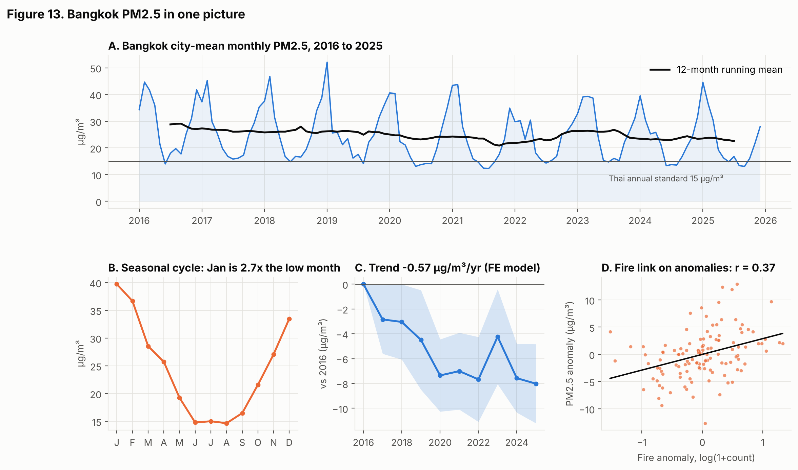
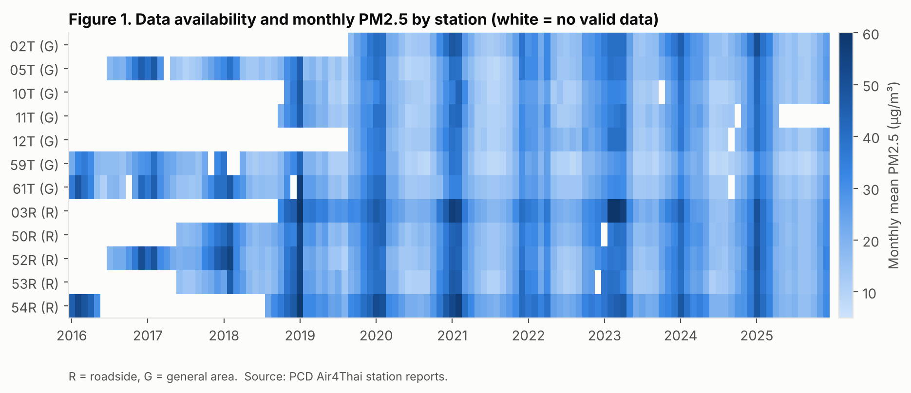
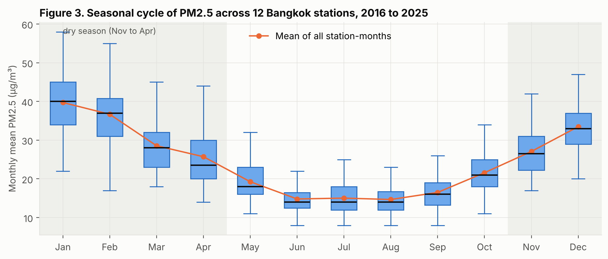
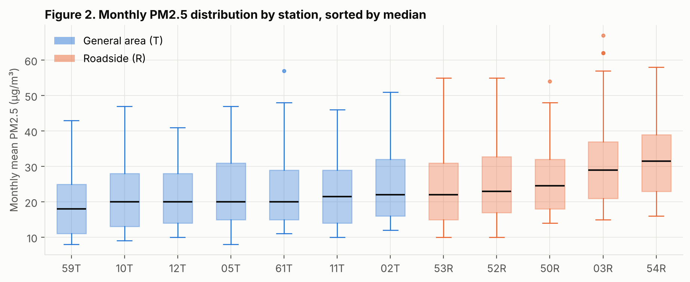
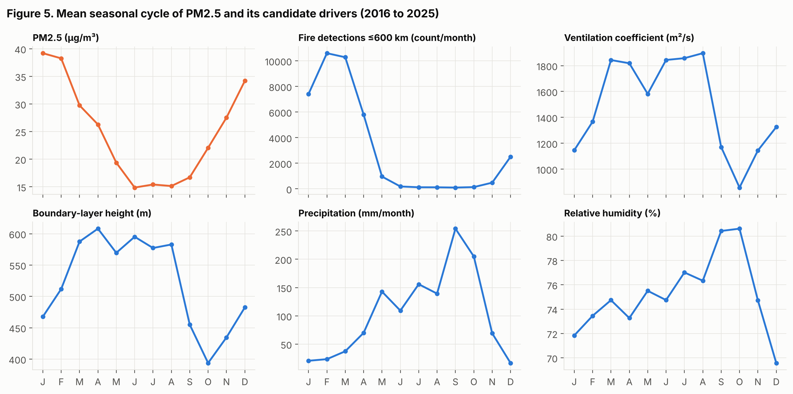
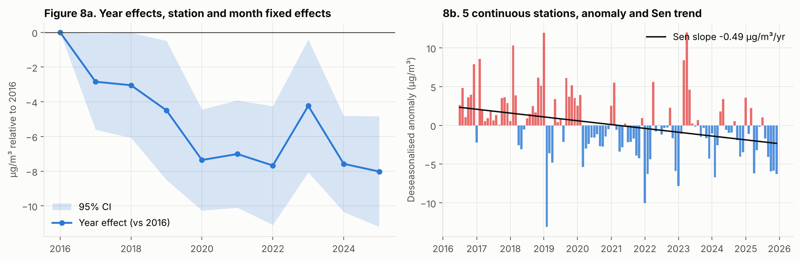
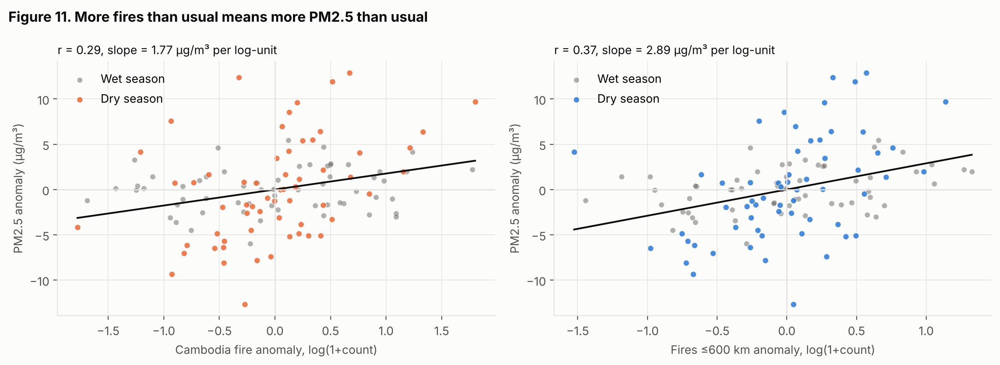
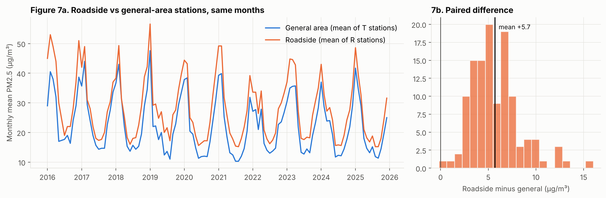
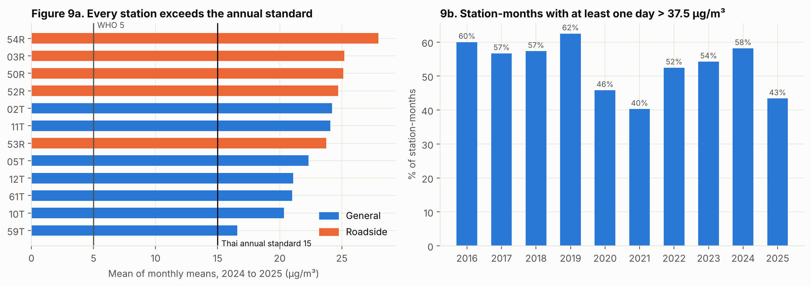
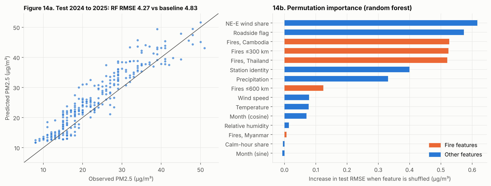

# Bangkok's PM2.5 Problem, 2016 to 2025
### Seasonality, long-term trend, and the role of regional biomass burning

**2107540 Data Science for Environment and Sustainability, Project 1** · Chulalongkorn University
Kan Prangwattanakul (6732003021)



---

## 1. Environmental problem
Fine particulate matter (PM2.5, particles ≤ 2.5 µm) penetrates deep into the lungs and bloodstream and is linked to respiratory and cardiovascular disease.
Bangkok exceeds the Thai 24-hour standard every dry season, and its annual mean is several times the WHO guideline.
Public debate blames either **local traffic** or **agricultural and forest burning**, but these claims are rarely tested with long-run monitoring data.

**Research questions**
| # | Question |
|---|---|
| RQ1 | How strongly does PM2.5 vary by season, and between roadside and general-area stations? |
| RQ2 | Has PM2.5 decreased from 2016 to 2025 once season and changes in the station network are controlled for? |
| RQ3 | How much of the month-to-month variation is linked to regional fires versus meteorology? |
| RQ4 | How far is Bangkok from the Thai standards and the WHO guideline? |
| RQ5 (optional ML) | Can meteorology and fire data predict monthly PM2.5 better than a seasonal baseline? |

**Air-quality benchmarks used**
| Benchmark | 24-hour mean | Annual mean |
|---|---|---|
| Thai standard (National Environment Board notification, 2022) | 50 µg/m³ until 31 May 2023, **37.5 µg/m³** from 1 Jun 2023 | **15 µg/m³** |
| WHO Global Air Quality Guidelines (2021) | 15 µg/m³ | 5 µg/m³ |

---

## 2. Dataset sources
| Dataset | Provider | What was used | Access |
|---|---|---|---|
| **PM2.5 monthly station reports** (119 one-page PDFs) | Pollution Control Department (PCD), Air4Thai | 12 Bangkok stations (5 roadside, 7 general area), 2016 to 2025: monthly mean, max and min 24-h mean, days above standard | `https://air4thai.com/forweb/getReport.php?file=<STATION>_<YEAR>` (Air4Thai: History, monthly summary) |
| **ERA5 reanalysis**, hourly | ECMWF, via the Open-Meteo Historical Weather API | Central Bangkok (13.75°N, 100.50°E): temperature, humidity, precipitation, wind speed and direction, boundary-layer height | `https://archive-api.open-meteo.com/v1/archive` (exact query in the notebook, Part 1.2) |
| **Active-fire detections**, MODIS C6.1 | NASA FIRMS | Thailand, Cambodia, Myanmar, 2016 to 2025 | `https://firms.modaps.eosdis.nasa.gov/data/country/modis/<YEAR>/modis_<YEAR>_<COUNTRY>.csv` |

> **Why PDFs?** Air4Thai's online history API returns hourly data only for the most recent weeks. PCD's long-term, quality-checked record is published as one PDF table per station per year, so the PM2.5 data had to be extracted from PDFs (Part 3 below).

---

## 3. Data Cleaning and Transformation
**PM2.5 (PDF to table), `src/parse_air4thai.py`**
* The report layout changed several times (margins, which pollutant blocks appear, whether a PM2.5 analyser existed), so a fixed column order would silently read PM10 as PM2.5.
* The parser anchors the 12 month rows on the Thai month labels, clusters the x-position of every value into columns, and accepts the right-most block as PM2.5 **only if the standard printed under it is 50 or 37.5 µg/m³**. Thirteen station-years whose right-most block is PM10 (standard 120) were correctly identified as having no PM2.5.
* The output is checked against values read by hand from the PDF (50R, 2024).

**Quality control**
* 1,177 station-months had a PM2.5 value; 17 flagged `**` by PCD (< 50 % valid data) were removed, leaving **1,160 station-months**. The 24 months flagged `*` (50 to 75 %) were kept with their flag.
* Logical check min24h ≤ mean ≤ max24h (no failures after QC) and duplicate check on station-year-month (0 duplicates).
* The **2023 change in the standard** makes exceedance-day counts before and after 1 Jun 2023 non-comparable. For long-run comparison a consistent metric is used instead (months whose maximum 24-h mean exceeded 37.5 µg/m³).

**Meteorology**: hourly values were aggregated to monthly; I derived the **ventilation coefficient** VC = wind speed × boundary-layer height (m²/s), the calm-hour share and the share of north-east to east winds.
**Data gap found:** ERA5 has no boundary-layer height for Jan to Jul 2024; it was left missing, not filled in.

**Fires, `src/process_firms.py`**: kept vegetation fires only (`type = 0`), confidence ≥ 30, within 600 km of central Bangkok. The result is 386,979 detections, aggregated to monthly counts and fire radiative power by distance ring and country.

**Network change:** stations joined at different times (02T and 12T only in late 2019), so a plain city average mixes real change with changes in which stations are reporting. The trend is therefore estimated with **station fixed effects**, and checked against the 5 stations that cover the whole period.

---

## 4. Exploratory Data Analysis (EDA)
| | |
|---|---|
|  |  |
| **Fig 1.** Data availability: the network grew in 2017 and 2018 to 2019 | **Fig 3.** Seasonal cycle: January 39.7 vs August 14.7 µg/m³ (**2.7×**) |
|  |  |
| **Fig 2.** The 5 highest-median stations are exactly the 5 roadside stations | **Fig 5.** Fires peak in Feb to Mar; ventilation is lowest in Oct; rain keeps October clean |

Also in the notebook: descriptive statistics with skewness and kurtosis; the **1.5 × IQR outlier rule** per station (5 high values, all real dry-season episodes, kept rather than deleted); an **STL decomposition** of the 5 continuous stations (Fig 4b: seasonal component carries 97 % of the variance, trend falls from 27.2 to 23.6 µg/m³ between the first and last year); the year by month heat map (Fig 4); and the correlation matrix (Fig 6, Spearman). Raw correlations mostly reflect *shared seasonality*, so Part 5 tests the drivers on **anomalies**.

---

## 5. Data Analysis and Insights Extraction
| Finding | Evidence |
|---|---|
| **Roadside stations are about 25 % higher.** | Paired same-month difference **+5.7 µg/m³ (95 % bootstrap CI 5.3 to 6.2)**; roadside higher in 99 % of 119 months; Wilcoxon p < 10⁻²⁰ (Fig 7) |
| **PM2.5 is declining.** | Station and month fixed-effects model: **−0.57 µg/m³ per year (95 % CI −0.83 to −0.32, p < 0.001)**, about 23 % per decade. Seasonal Mann-Kendall on the 5 continuous stations: Sen slope −0.49 µg/m³/yr, p < 0.001 (Fig 8) |
| **Every station still exceeds the annual standard.** | 2024 to 2025 station means **16.6 to 28.0 µg/m³** vs Thai 15 / WHO 5; **12.7 %** of valid station-days were above 37.5 µg/m³ (18 to 75 days/yr depending on station) (Fig 9) |
| **More fires than usual means more PM2.5 than usual.** | Correlation of monthly anomalies: r = 0.37 (all months), 0.45 (dry season), p < 0.001 (Figs 10 and 11) |
| **But fires and dry weather act together.** | Fire-heavy months are also drier (anomaly r with humidity −0.35, rain −0.43). Controlling for rain, humidity and ventilation, the fire coefficient falls from +2.3 (p = 0.006) to +1.1 µg/m³ per log-unit (p = 0.23), and VC becomes negative, the physically expected sign (notebook Part 4.4) |

---

## 6. Data Visualization
All figures are in [`figures/`](figures/). They use a single colour-blind-validated palette (blue = general area, orange = roadside or fires), thin marks and hairline grids, and no dual axes (variables with different units are shown as small multiples).

| | |
|---|---|
|  |  |
|  |  |

---

## 7. Basic Machine Learning (optional)
**Task:** predict a station's monthly PM2.5 from season, station type and identity, ERA5 meteorology and regional fire counts.
**Validation:** time-based only (no random K-fold, which leaks information between neighbouring months). The baseline to beat is each station's 2016 to 2023 average for that calendar month.

| Model | Hold-out 2024 to 2025 RMSE (µg/m³) | R² | Rolling-origin 2021 to 2025 mean RMSE |
|---|---|---|---|
| Mean baseline (`DummyRegressor`) | 9.66 | −0.04 | 10.03 |
| Climatology baseline (station × month mean) | 4.83 | 0.74 | 5.63 |
| Ridge regression (`Pipeline`: StandardScaler + Ridge) | 4.69 | 0.76 | 5.13 |
| **Random forest** (tuned with `GridSearchCV`) | **4.27** | **0.80** | **4.76** |
| Gradient boosting | 5.53 | 0.66 | 5.38 |

Random-forest hyper-parameters were chosen with `GridSearchCV` on chronological folds inside the training years only (best: `max_features = 0.33`, `min_samples_leaf = 1`). The random forest cuts error by about 12 % (hold-out) and 16 % (rolling) compared with the climatology baseline. The share of north-east to east winds and the roadside flag rank highest in permutation importance, followed closely by three fire-count features (Cambodia, within 300 km, Thailand) (Fig 14).



---

## 8. Environmental interpretation
1. **A dry-season problem.** The January peak coincides with the north-east monsoon: dry, cool, stable air with almost no rain. October has even poorer ventilation, but heavy rain removes particles (**wet deposition**), so PM2.5 stays moderate.
2. **Traffic is the controllable local layer.** The roughly 5.7 µg/m³ roadside excess (exhaust, especially diesel, road dust and street-canyon trapping) is what city measures can reduce directly: low-emission zones, diesel and heavy-vehicle controls, bus electrification.
3. **Regional burning makes bad seasons worse, together with weather.** Fire activity is the strongest extra signal (anomaly correlation and top ML feature), but it coincides with dry, stagnant weather, and monthly data cannot fully separate the two. Bangkok's worst seasons therefore need **provincial and transboundary** action on crop-residue and forest burning, alongside local controls.
4. **Improving, but far from the targets.** A decline of about 0.57 µg/m³/yr is real and consistent across methods. At that rate the city mean (about 23 µg/m³ in 2024 to 2025) would take more than a decade to reach the Thai annual standard of 15 µg/m³, and would remain far above the WHO 5 µg/m³.

**Recommendations:** prioritise traffic controls at roadside hot spots (54R Din Daeng, 03R Kanchanaphisek, 50R Rama IV); use FIRMS fire counts as an early-warning input from January to March; pursue transboundary cooperation on burning; and publish **daily** station data as open CSV.

**Limitations:** monthly resolution (day-scale stagnation and smoke episodes are averaged out); one ERA5 grid cell for the whole city, with a BLH gap in 2024; fire *detections* are not *emissions*; correlation is not source attribution (that would need chemical speciation or a chemical-transport model).

---

## How this project follows the 2107540 workflow
| Course workflow step | Where it is in this project | Course methods used |
|---|---|---|
| **Define & Ask** | Section 1, research questions RQ1 to RQ5 | |
| **Acquire & Prepare** | Sections 2 and 3, notebook Parts 1 and 2 | importing several file formats, `isna()`, duplicates, type conversion, datetime features, documented missing-value strategy (left missing, not filled), aggregation |
| **Analyze & Interpret** | Sections 4 and 5, notebook Parts 3 and 4 | descriptive statistics, skewness, 1.5 × IQR rule, Pearson vs Spearman, correlation ≠ causation (confounding check), STL decomposition |
| **Visualize & Communicate** | Section 6, `figures/`, presentation | box plots, histograms, line and scatter plots, heat maps, small multiples; categorical, sequential and diverging colour used by job; no 3D or chartjunk |
| **Machine learning** (optional) | Section 7, notebook Part 6 | chronological train/test split, cross-validation without leakage, `Pipeline`, `StandardScaler`, one-hot encoding, `DummyRegressor` baseline, `GridSearchCV`, MAE / RMSE / R², random forest |

## Repository structure
```
Environmental-DS-Project/
├── README.md
├── requirements.txt
├── results.json                    # every headline number, written by the notebook
├── data/
│   ├── raw/
│   │   ├── air4thai_station_reports/   # 119 original PCD PDFs (STATION_YEAR.pdf)
│   │   ├── open_meteo/                 # ERA5 hourly CSV, 2016 to 2025
│   │   └── firms_modis/                # filtered NASA FIRMS detections (.csv.gz) + source note
│   └── processed/                      # parsed and cleaned tables written by the notebook
├── notebooks/
│   └── DS_analysis.ipynb               # full analysis, Parts 1 to 6 + interpretation
├── figures/                            # all figures (PNG, 200 dpi)
└── src/
    ├── parse_air4thai.py               # PDF table extractor
    ├── process_firms.py                # FIRMS filtering (raw country files to filtered CSV)
    └── build_notebook.py               # generates the notebook from source
```

## How to reproduce
```bash
pip install -r requirements.txt
jupyter nbconvert --to notebook --execute --inplace notebooks/DS_analysis.ipynb
```
The notebook runs from the files in `data/raw/` and rewrites `data/processed/`, `figures/` and `results.json`.
To rebuild the FIRMS file from scratch, download the country-year CSVs listed in Section 2 into a folder and run `python src/process_firms.py <folder> data/raw/firms_modis/firms_modis_vegfires_600km_bangkok_2016_2025.csv`, then gzip the output.

## References
* Pollution Control Department, Air4Thai: station reports and station metadata, https://air4thai.pcd.go.th
* Notification of the National Environment Board on the ambient PM2.5 standard (Royal Gazette, 8 July 2022): 24-h 37.5 µg/m³ from 1 June 2023, annual 15 µg/m³.
* World Health Organization (2021). *WHO global air quality guidelines: particulate matter (PM2.5 and PM10), ozone, nitrogen dioxide, sulfur dioxide and carbon monoxide.*
* Hersbach, H. et al. (2020). The ERA5 global reanalysis. *Q. J. R. Meteorol. Soc.* 146, 1999 to 2049. Accessed through Open-Meteo (Zippenfenig, P., Open-Meteo.com Weather API).
* NASA FIRMS, MODIS Collection 6.1 Active Fire Product (MCD14ML), https://firms.modaps.eosdis.nasa.gov
